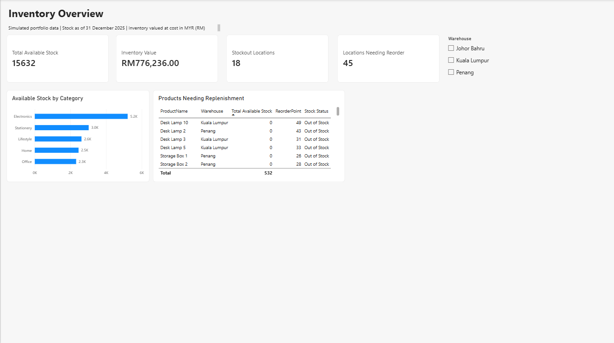
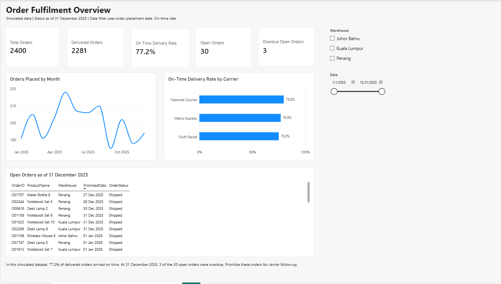
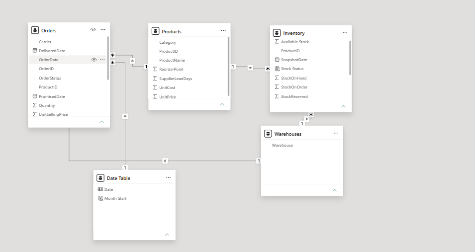

# powerbi-inventory-fulfilment
Power BI portfolio project using simulated data to analyse inventory availability, reorder alerts, and order delivery performance.
# Inventory and Order Fulfilment | Power BI

A two-page Power BI portfolio project showing stock availability, replenishment alerts, and delivery performance.

**All source data is simulated. Findings demonstrate analytical methods and do not describe a real business.**

## Dashboard previews

## Business questions

- Which products and warehouses need replenishment?
- How much stock is available, and what is inventory worth at cost?
- What percentage of delivered orders arrived on time?
- Which open orders require follow-up?

## Dataset

The included simulated Excel workbook contains:

- 60 products
- 180 product–warehouse inventory records
- 2,400 orders placed during 2025
- Three warehouses: Kuala Lumpur, Penang, and Johor Bahru

Inventory and order statuses are reported as of **31 December 2025**. Currency is **MYR (RM)**.

Each order contains one product. Inventory is a single-date snapshot.

## Data preparation and modelling

Used Power Query to set data types, convert timestamp fields to dates, and calculate available stock.

Products and Warehouses filter both Inventory and Orders through active, single-direction relationships. A dedicated Date Table filters Orders by order placement date.

## Report pages

**Inventory Overview:** Available stock, inventory value, stockout counts, reorder alerts, stock by category, and a replenishment detail table.

**Order Fulfilment:** Order counts, on-time delivery rate, open and overdue orders, monthly order trends, carrier performance, and open-order details.

## Results in the simulated dataset

- **15,632** available stock units
- **RM776,236.00** inventory value at cost
- **18** product–warehouse combinations out of stock
- **45** product–warehouse combinations needing reorder, including stockouts
- **2,281** delivered orders out of **2,400** total orders
- **77.2%** on-time delivery rate among delivered orders
- **30** open orders, of which **3** were overdue

## Metric definitions

- **Available stock:** Stock on hand minus reserved stock.
- **Inventory value:** Stock on hand multiplied by product unit cost, including reserved units.
- **Out of stock:** Zero available units at a product–warehouse combination.
- **Needs reorder:** Available stock at or below the product’s reorder point.
- **On-time delivery rate:** Delivered orders arriving on or before their promised date, divided by delivered orders.
- **Open orders:** Orders marked Processing or Shipped.
- **Overdue open orders:** Open orders with a promised date before 31 December 2025.

The date slicer selects orders by placement date. Status remains measured at the fixed reporting date.

## Suggested actions

Prioritise stockouts for replenishment review, checking inbound stock before ordering. Follow up on overdue open orders and investigate delivery delays by carrier.

These are demonstration recommendations, not evidence of achieved business improvements.

## Limitations

- The dataset is synthetic and does not establish real operational performance.
- Inventory snapshots were generated independently of historical orders.
- Historical stock movements and inventory turnover cannot be calculated from this data.
- Orders have no partial shipments or returns.
- Carrier comparisons are descriptive and do not establish causes of delays.

## Skills demonstrated

Power Query, DAX, dimensional modelling with two fact tables, shared lookup tables, date modelling, operational metrics, interactive filters, and report design.

## Files and usage

- **Inventory and Order Fulfilment.pbix** — interactive report
- **Inventory and Order Fulfilment.pdf** — static preview
- **Inventory_Fulfilment_Simulated.xlsx** — source data and definitions
- **inventory-overview.png** — inventory page screenshot
- **order-fulfilment.png** — fulfilment page screenshot
- **data-model.png** — relationship model screenshot

Open the PBIX in Power BI Desktop. To refresh, update the Excel source path in Power Query to the downloaded workbook’s location.
